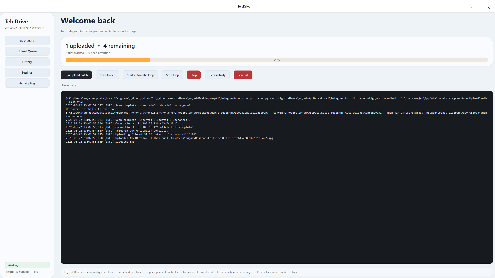
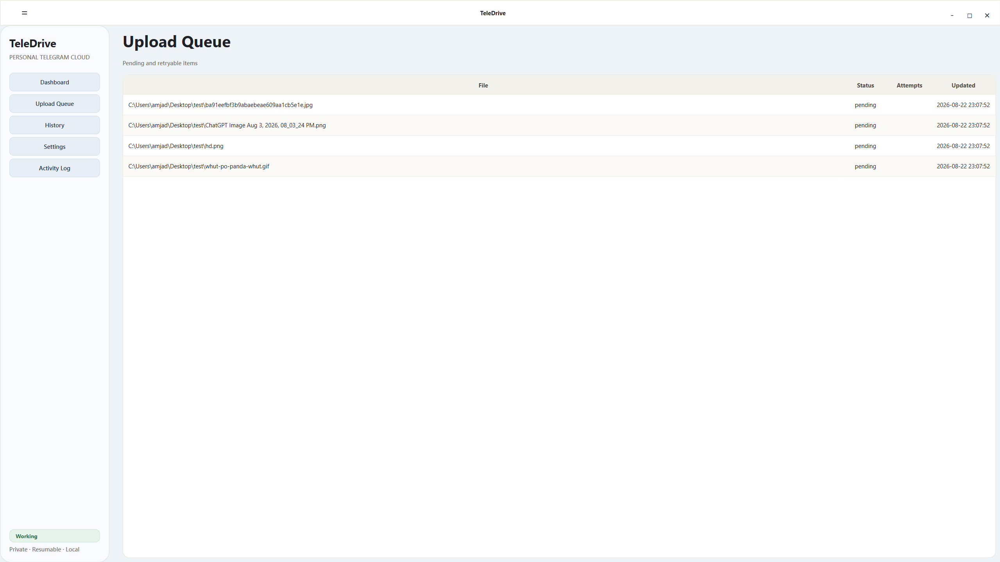
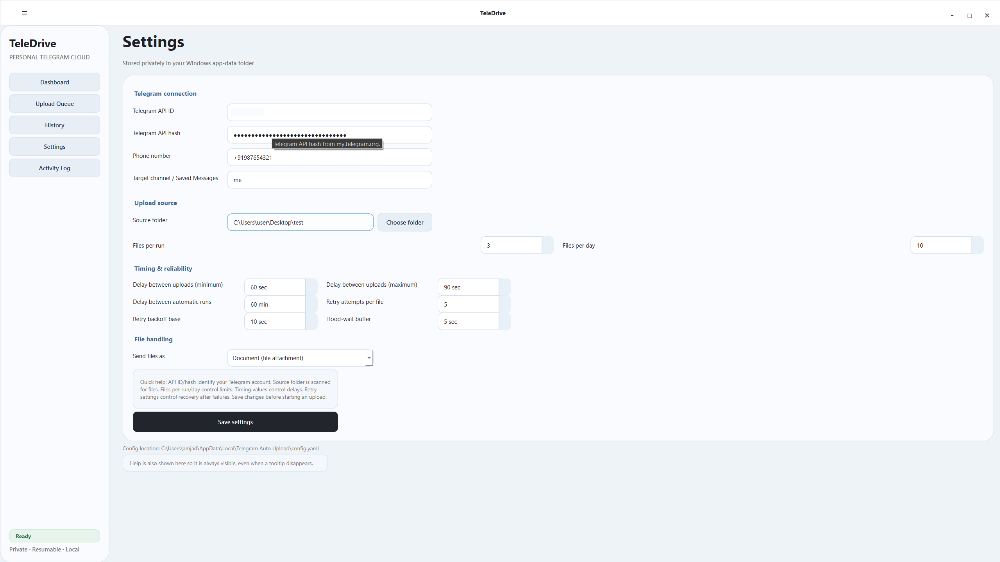

# TeleDrive

**Telegram-backed personal file storage and automation** with a single-container Web UI/REST/S3 service, a Windows/Linux desktop application, and a command-line uploader.

TeleDrive stores object payloads in Telegram and keeps object metadata, upload state, and references in a local or external SQL database. This fork supports multiple Telegram accounts for the original folder uploader and a Bot-backed, shared object catalog for REST, S3, and durable local-file jobs.

> **Security:** ordinary Telegram cloud chats and Saved Messages are **not end-to-end encrypted**. Encrypt sensitive content before uploading if it must be confidential from Telegram.
>
> **Release boundary:** [v1.0.7](https://github.com/babico/TeleDrive/releases/tag/v1.0.7) is the published milestone. Newer `main` features may not be included in those binaries. Refer to [Project Status](docs/IMPLEMENTATION_STATUS.md) before treating unreleased features as production-ready.

## Documentation

| Guide | Use it for |
| --- | --- |
| **[README](README.md)** | Installation, configuration, primary workflows and supported interfaces |
| [CI and Test Guide](docs/CI_WORKFLOWS.md) | GitHub Actions, local tests, Docker fault injection and development acceptance |
| [Project Status and Acceptance](docs/IMPLEMENTATION_STATUS.md) | P0/P1/P2 capabilities, release boundaries, original-data production acceptance and recovery risks |
| [Backup and Restore](docs/BACKUP_RESTORE.md) | Database backup commands, isolation and restore checks |
| [Security Policy](docs/SECURITY.md) | Responsible disclosure, trusted components, credentials and network isolation |
| [Contributing](CONTRIBUTING.md) | Development workflow and documentation rules |
| [S3 Compatibility Matrix](docs/S3_SPECS.md) | 116-operation status matrix, supported limits and P2 advanced implementation roadmap |
| [Working Checklist](TODO.md) | Short, actionable outstanding tasks |

**Contents:** [Quick start](#1-quick-start-docker) · [Architecture](#2-storage-architecture) · [REST API](#3-rest-api) · [S3 gateway](#4-s3-compatible-api) · [Local jobs](#5-local-file-upload-jobs) · [Desktop/CLI](#6-desktop-and-command-line-usage) · [Databases](#7-database-configuration) · [Security](#8-security-and-operational-limits) · [Development](#9-development-and-testing).

## 1. Quick start: Docker

Prerequisites: Docker Engine, Docker Compose v2 and a Telegram account for the legacy uploader. For REST/S3 object storage, additionally configure a Bot with posting permission in a dedicated private Telegram channel.

~~~bash
git clone https://github.com/babico/TeleDrive.git
cd TeleDrive
mkdir -p config data uploads
cp .env.example .env
cp examples/config.docker.yaml config/config.yaml
chmod 600 .env config/config.yaml
~~~

In `.env` set a unique `TELEDRIVE_WEB_PASSWORD` of at least 16 characters; adjust `PUID` and `PGID` to match the owner of the mounted directories. In `config/config.yaml` set the Telegram API ID/hash and account configuration as appropriate.

~~~bash
docker compose up -d --build
docker compose ps
docker compose logs -f teledrive
~~~

| Endpoint | Host-local address | Purpose |
| --- | --- | --- |
| Web UI, admin REST API, Swagger | [`http://127.0.0.1:8080`](http://127.0.0.1:8080) | Account management, jobs, REST and API keys |
| SigV4 S3 gateway | `http://127.0.0.1:9000` | Path-style S3 endpoint for SDKs and CLI clients |

**One service, one container, one Python process.** Both listeners use the **same SQL catalog and Telegram object engine**. You do not need `docker compose --profile s3` and there is no second S3 container.

Ports bind to loopback by default (`TELEDRIVE_BIND_ADDRESS=127.0.0.1`). For remote access, use an SSH tunnel, private VPN, or an HTTPS reverse proxy; never expose Basic credentials or S3 secrets over untrusted plaintext HTTP.

| Host folder | Container path | Purpose |
| --- | --- | --- |
| `./config` | `/config` | Settings and S3 master key |
| `./data` | `/data` | Sessions, metadata and internal temporary state |
| `./uploads` | `/uploads:ro` | Read-only source files for explicitly queued jobs |

To use a different source directory, change the host side of the `/uploads` mount, retaining the container-side path and read-only mode. The image has no GUI/X11/PySide6 dependency.

**Configure S3 before writing:** the gateway listener starts automatically, but writing S3 objects requires Telegram Bot credentials, a persistent encryption key and scoped S3 credentials. See [Section 4](#4-s3-compatible-api).

## 2. Storage architecture

### Shared object catalog

| Entry point | How it writes | Can REST/S3 read it? |
| --- | --- | --- |
| REST `PUT /api/v1/buckets/{bucket}/content` | Bot API → `TelegramObjectStorage` → `BucketCatalog` | **Yes** |
| Signed S3 `PutObject` / multipart upload | Same Telegram chunk engine and SQL catalog | **Yes** |
| Authenticated local-file upload job | Explicit queued file → same Bot-backed object catalog | **Yes**, after the job finishes |
| Original Telethon folder scan/batch | User-session uploader and its legacy workflow | **Not automatically**; use the shared-job path for REST/S3 visibility |

The SQL catalog stores object heads, generations, checksums, version references, job state and encrypted S3 credential metadata. Object payloads remain in Telegram; the temporary upload scratch directory is **not** a second primary storage backend. Completed transfers have SHA-256 checks and byte-range reads. Failed/unknown Telegram acknowledgments remain protected from unsafe physical deletion.

### Telegram accounts and transport choices

The original uploader accepts Telegram user accounts through MTProto/Telethon; a user account can use Saved Messages (`me`), channel usernames, or supported numeric target IDs. Each account has its own session and optional API/target overrides.

| Strategy | Behavior |
| --- | --- |
| `single` | Use the first enabled account |
| `round_robin` | Rotate preferred sending accounts between files |
| `failover` | Try configured accounts in priority order |
| `parallel` | Independent account-affine workers with fallback |

**Saved Messages belong to each user account separately.** Use a shared private channel if all uploader accounts must target the same destination. Respect Telegram rate limits; never share a writable Telethon session file across independent worker processes.

The **REST/S3 shared object service uses the Telegram Bot API**, not a Telethon user login. It requires a Bot token and numeric private channel ID. The official hosted Bot API limits file downloads to 20 MiB per Telegram file, so the object engine uses bounded Telegram chunks (normally 16 MiB) for larger objects. These are two supported transport modes with different access/recovery constraints; they must not be conflated.

## 3. REST API

The Web listener publishes an authenticated interface at:

| Endpoint | Purpose |
| --- | --- |
| `http://127.0.0.1:8080/docs` | Swagger UI |
| `http://127.0.0.1:8080/redoc` | ReDoc |
| `http://127.0.0.1:8080/openapi.json` | Machine-readable OpenAPI schema |

~~~bash
curl -u "admin:YOUR_PASSWORD" http://127.0.0.1:8080/openapi.json
~~~

Use HTTP Basic authentication for administrative API key issuance/rotation/revocation and include `X-TeleDrive-CSRF: 1` on administrative mutations. REST object calls use separately issued, scoped Bearer API keys; those are **not** S3 Access Key IDs.

Key operations include bucket management, object listing, logical unlink, full object upload/download, metadata-only HEAD and checksum-verified Range GET. Administrative keys are shown once; only digests are persisted.

~~~bash
# First create the bucket and issue a scoped REST key in API Management.
curl -f -X PUT \
  'http://127.0.0.1:8080/api/v1/buckets/backups/content?key=folder%2Ffile.bin' \
  -H "Authorization: Bearer $TELEDRIVE_API_KEY" \
  -H 'Content-Type: application/octet-stream' \
  --data-binary '@file.bin'

curl -f -H "Authorization: Bearer $TELEDRIVE_API_KEY" \
  'http://127.0.0.1:8080/api/v1/buckets/backups/content?key=folder%2Ffile.bin' \
  -o restored.bin
~~~

The default REST upload ceiling is 2 GiB, configurable with `TELEDRIVE_REST_MAX_UPLOAD_BYTES`. Uploads require the configured Telegram storage Bot and permitted private channel. Physical Telegram message deletion is **not** implied by an HTTP object delete.

## 4. S3-compatible API

For the **116-operation AWS S3 API compatibility matrix**, parameter-level limitations, unsupported-operation groups, and the P2 Advanced S3 work plan, see [S3 Specifications](docs/S3_SPECS.md).

The S3 endpoint is **part of the default container**, not a separate Compose profile. It implements a tested **subset** of S3 over the shared Telegram-backed catalog. It is **not AWS S3 feature parity**.

### Provision the S3 master key and credentials

1. Set `TELEDRIVE_STORAGE_BOT_TOKEN` and `TELEDRIVE_STORAGE_BOT_CHAT_ID` in the private `.env` file. Add the Bot as an admin with posting rights in the dedicated private Telegram channel.
2. Generate a persistent master encryption key once, on the trusted host:

~~~bash
python - <<'PY'
from pathlib import Path
from cryptography.fernet import Fernet
target = Path("config/s3-master.key")
if target.exists():
    raise SystemExit("Refusing to replace the existing S3 master key")
with target.open("xb") as stream:
    stream.write(Fernet.generate_key() + b"\n")
target.chmod(0o600)
PY
~~~

3. Install the `cryptography` package on the host if necessary. Ensure the container's `PUID`/`PGID` can **read** this file. Back up the key separately: losing it makes stored S3 secrets undecryptable.
4. Start the default Compose service and issue a **scoped** S3 access key and secret in **WebUI → API Management → S3-compatible gateway** (or the desktop S3 Management page). The secret appears once and is encrypted in SQL. When sharing metadata with Desktop, point it at the **same** master key rather than silently creating another.

### SDK example

~~~python
import boto3
from botocore.config import Config

client = boto3.client(
    "s3",
    endpoint_url="http://127.0.0.1:9000",
    aws_access_key_id="YOUR_ACCESS_KEY_ID",
    aws_secret_access_key="YOUR_SECRET_ACCESS_KEY",
    region_name="us-east-1",
    config=Config(
        signature_version="s3v4",
        s3={"addressing_style": "path", "payload_signing_enabled": True},
        request_checksum_calculation="when_required",
        response_checksum_validation="when_required",
    ),
)
client.create_bucket(Bucket="backup-bucket")
client.put_object(Bucket="backup-bucket", Key="hello.txt", Body=b"Hello Telegram")
assert client.get_object(Bucket="backup-bucket", Key="hello.txt")["Body"].read() == b"Hello Telegram"
~~~

### Implemented features and limits

| Feature group | Available behavior |
| --- | --- |
| Authentication | Scoped encrypted S3 keys, SigV4 request checks, bounded signed/presigned operations |
| Buckets and listing | Create/Head/DeleteBucket; V1/V2 object listing, prefixes, delimiters, marker/continuation and URL encoding |
| Objects | Put/Get/Head/Delete (logical unlink), Range, CopyObject, conditional GET/HEAD and signed conditional writes/deletes |
| Multipart | UploadPart, Complete/Abort and guarded stale-completion recovery through an admin-only API |
| Metadata and versions | Selected published VersionId reads/listing, always-Enabled versioning, fixed private-only Public Access Block and incomplete-MPU lifecycle abort rules, object/bucket tags, metadata, CopySource, CORS and GetObjectAttributes (`ETag`, `ObjectSize`, full-object SHA-256 `Checksum`, `STANDARD`, historical `VersionId`, immutable multipart `ObjectParts` with bounded pagination) |
| Checksums | SHA-256, SHA-1, Content-MD5, CRC32, CRC32C and CRC64NVME validation where explicitly implemented |
| Known gaps | Object lifecycle expiration/transitions, bucket policies, SSE, full AWS delete-marker semantics, every multipart POST variant and unverified clients |

**Safety:** `UNSIGNED-PAYLOAD` writes are accepted only when an appropriately **signed, verifiable** checksum binds the actual received bytes. Public ACLs and unsupported archival tiers must not be inferred from AWS-style parameters. Failed conditional publications may retain protected, unpublished Telegram manifests rather than deleting uncertain remote media.

S3 client integrations tested in CI use **real** AWS CLI and rclone executables against the actual gateway and SQL with **synthetic Telegram transport**; real Telegram byte transfer is tested in separate live E2E workflows. For rclone use `type=s3`, `provider=Other`, `force_path_style=true` and your issued S3 key pair. Create buckets first if `no_check_bucket=true`.

### Non-destructive storage and multipart maintenance

Before considering stale multipart recovery or garbage collection, inspect the admin-only endpoints and **dry-run** responses. The admin API provides `/api/v1/admin/s3-multipart/stale`, `/api/v1/admin/s3-multipart/{upload_id}/recover` (with `"execute": false` for preview), and `/api/v1/admin/storage/gc-candidates`. A stale completion may be explicitly returned to `active` under expiry/fencing conditions; it is not equivalent to deleting Telegram messages.

**Physical Telegram garbage collection remains disabled** until independently verified owner/alias/version/retention/backup/fencing controls and approval exist. The [P2 safety section](docs/IMPLEMENTATION_STATUS.md#41-physical-telegram-garbage-collection-disabled) describes the incomplete safeguards.

## 5. Local-file upload jobs

The Docker mount `./uploads:/uploads:ro` gives the service read-only access to approved source files. Use the authenticated **durable job API** to publish files into the **same REST/S3 catalog**.

~~~bash
# Ensure the bucket exists. Then enqueue an existing local file:
curl -fsS -u "$TELEDRIVE_WEB_USER:$TELEDRIVE_WEB_PASSWORD" \
  -H "X-TeleDrive-CSRF: 1" \
  -H "Content-Type: application/json" \
  -d '{"bucket":"backups","key":"local/example.bin","source_path":"/uploads/example.bin"}' \
  http://127.0.0.1:8080/api/v1/admin/storage/jobs
~~~

In Docker Compose, `TELEDRIVE_JOB_AUTO_RUN=1` processes **explicitly queued** jobs automatically. Set it to `0` to disable background processing while retaining queue entries. **A copy into `/uploads` does not automatically trigger a scan or upload.**

Jobs are persisted in SQL and protect against source mutation, unexpected generation changes and interrupted uploads. Keep the source file until the job reaches `done`. The admin API also supports job inspection/retry, stale-pending previews, history restore and safe health checks. Failed/uncertain remote sends do not authorize physical cleanup.

## 6. Desktop and command-line usage

### Windows and Linux desktop

The PySide6 application provides account-scoped login/2FA, multi-account scheduling, configuration, queue/history, and database settings.

~~~bash
python -m pip install -r requirements/desktop.txt
python -m app.main
~~~

Desktop configuration examples live at [`examples/config.desktop.yaml`](examples/config.desktop.yaml). User data is located under `%LOCALAPPDATA%/Telegram Auto Upload` on Windows or `~/.local/share/Telegram Auto Upload` on Linux (unless `XDG_DATA_HOME` overrides the latter).

Build scripts:

~~~powershell
# Windows; run in PowerShell:
./scripts/build.ps1
./scripts/build-installer.ps1
~~~

~~~bash
# Linux:
bash scripts/build-linux.sh
~~~

### Headless folder uploader

The original Telethon scanner can run without a GUI:

~~~bash
cp examples/config.desktop.yaml local-config.yaml
# Edit credentials, source root, target and database settings first.
python -m teledrive.uploader --config local-config.yaml --scan-only
python -m teledrive.uploader --config local-config.yaml --run-once
~~~

WebUI automation is configured through **Settings → Automation**. Do not launch multiple client processes against the same writable Telethon session file. The original direct-send legacy scanner uses a distinct upload path from the REST/S3 catalog. For **unified ingestion in the existing single container**, first create a bucket, disable legacy `app.auto_run`, place the configured `upload.source_dir` under the read-only `/uploads` mount, and opt in with `TELEDRIVE_JOB_LEGACY_AUTO_BUCKET=<bucket>` in `.env`. Optional `TELEDRIVE_JOB_LEGACY_AUTO_PREFIX` and `TELEDRIVE_JOB_LEGACY_AUTO_LIMIT` bound the queue. The scheduler uses the shared SQL catalog, fenced legacy scan, durable Bot transport and existing WebUI/REST/S3 service; it never starts the old Telethon direct-send path. The bucket setting is **empty by default** to prevent unintended source scanning or live-data migration. Never run both upload modes on the same source concurrently.

### Telegram account setup

1. Get a Telegram `api_id` and `api_hash` from [my.telegram.org](https://my.telegram.org/apps).
2. Choose `me`, a permitted channel username, or an appropriate numeric chat ID as the user-account uploader destination.
3. Authenticate with the Telegram code and, if enabled, 2FA password.
4. Test a small scan/upload and confirm readback before enabling scheduling.

A BotFather token is **not** required for the legacy user-account uploader; it **is** required for the REST/S3 object service. Never put account sessions, API hashes or Bot tokens in committed configuration.

## 7. Database configuration

Configure `state.database_url` in the YAML configuration or Web UI. SQLite needs no external server; the server image includes drivers for the tested PostgreSQL and MySQL/MariaDB integrations. Other synchronous SQLAlchemy dialects may work with separately reviewed drivers but are **not certified merely by accepting their URLs**.

~~~yaml
state:
  database_url: "sqlite:////data/state.db"
~~~

Representative alternatives:

~~~text
postgresql+psycopg://user:password@db:5432/teledrive
mysql+pymysql://user:password@db:3306/teledrive
~~~

For additional reviewed packages, set `TELEDRIVE_DB_EXTRA_PACKAGES` in `.env` and rebuild the Docker image. Some database drivers require OS libraries in a derived Docker image. Enable DB TLS remotely and use least-privilege credentials. Back up the DB together with Telegram access and the S3 master key; see [Backup and Restore](docs/BACKUP_RESTORE.md).

## 8. Security and operational limits

- Keep WebUI/REST/S3 on loopback unless protected by an HTTPS reverse proxy or VPN.
- Treat session files, `.env`, Bot tokens, `config.yaml`, the S3 master key and SQL backups as secrets.
- Docker defaults include non-root execution, a read-only filesystem, capability drops and a read-only source mount.
- Never assume a successful database-only restore is proof of original Telegram media recovery.
- Never enable automatic physical Telegram deletion or bypass unresolved ACK/reference fences.
- Use [Security Policy](docs/SECURITY.md) to report vulnerabilities privately and [Project Status](docs/IMPLEMENTATION_STATUS.md) to distinguish development CI from production acceptance.

## 9. Development and testing

The standalone Astro marketing site under [`website/`](website/) is **not** the Docker administration UI:

~~~bash
cd website
npm ci
npm run dev
npm run build
~~~

Repository layout:

| Directory | Purpose |
| --- | --- |
| `teledrive/` | Telegram uploader, object engine, SQL state, recovery, API/transport adapters |
| `web/` | Unified WebUI/REST/S3 ASGI service and admin interface |
| `app/` | PySide6 desktop application |
| `scripts/` | Setup, maintenance, CI and desktop packaging |
| `examples/` | Desktop and Docker configuration examples |
| `tests/` | Offline regression, integration and live test contracts |
| `.github/workflows/` | Categorized GitHub Actions pipelines |
| `.github/ci/` | Workflow-specific supporting Docker assets |
| `website/` | Marketing website |

~~~bash
python -m pip install -r requirements/server.txt pytest
python -m pytest -q
python -m compileall -q teledrive web app tests
docker compose config --quiet
# Isolated fault-injection acceptance:
bash scripts/run_docker_fault_injection.sh
~~~

The nine normal GitHub Actions workflows validate a given commit. Real Bot, user and multiworker tests use dedicated, private **test-only** Telegram credentials. For setup, run `python scripts/setup_telegram_e2e.py --channel "TeleDrive E2E Storage" --create-if-missing --configure-bot` from a trusted local machine; the bot must be an admin of that channel. Never upload live credentials to GitHub issues or the repository. See [CI and Test Guide](docs/CI_WORKFLOWS.md) for workflow names, command details, evidence and acceptance boundaries.

## Credits and license

Originally created by [Amjad P A](https://github.com/amjadlle/TeleDrive). Maintained here as the [babico/TeleDrive fork](https://github.com/babico/TeleDrive), with Docker, multi-account, REST/S3 and recovery enhancements. Licensed under [MIT](LICENSE).
